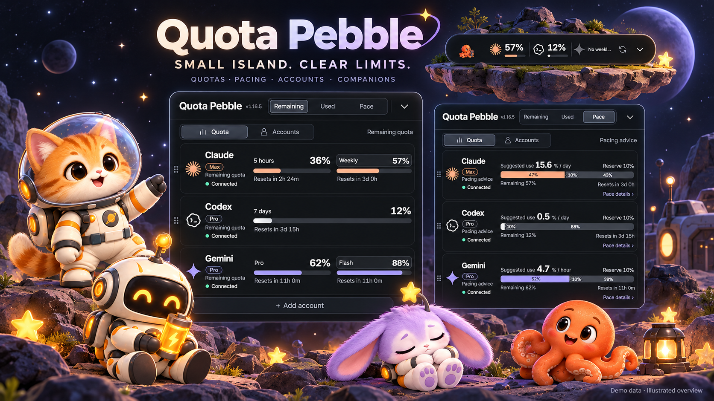
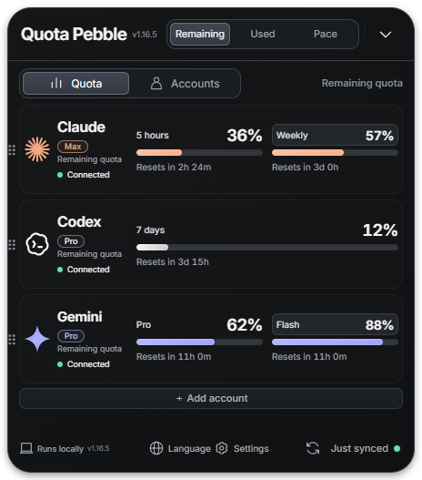
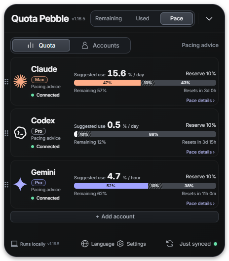
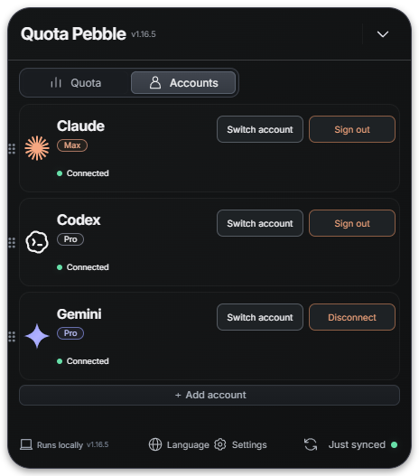

<h1 align="center">Quota Pebble</h1>
<p align="center"><b>Three AI subscriptions. One tiny island.</b><br>See your quota. Pace your day. Keep a little companion nearby.</p>
<p align="center"><a href="https://github.com/jaylooloomi/quota-island/releases/latest">Download for Windows</a> · <a href="README.zh-TW.md">繁體中文</a> · <a href="LICENSE">MIT</a></p>



*Illustrated overview generated from actual v1.16.5 screenshots. All pictured percentages are demo data.*

## Use cases

| Situation | What you do | What Pebble shows |
|---|---|---|
| Coding with several AI subscriptions | Keep the compact island nearby | Separate Claude, Codex and Gemini / Antigravity quotas |
| Planning work before the reset | Switch to Pacing | Suggested daily usage and an adjustable reserve |
| Using several Claude accounts | Add an account in the panel | Independent account cards; accounts are not added together |
| Needing a quiet desktop | Collapse, drag, or hide to the tray | A small, movable quota display |
| Taking a short break | Preview a companion action | Walking, greetings, feeling low, sleeping, water breaks or recharging |
| A quota service returns 429 | Wait for the next permitted attempt | Cooldown information rather than repeated requests |

## The product, in pictures

These are screenshots of the actual Windows app in isolated demo mode, not live customer accounts. Demo Gemini rows do not demonstrate every Antigravity quota group.

### A glance, then the details




Switch Remaining / Used / Pacing without changing the provider order. Drag cards to reorder, choose which services are visible, and inspect additional model windows when the source supplies them. Compact multi-account displays cycle individual accounts; their quotas are never summed.

### Pace your usage



The default reserve is **10% of total quota**. Guidance divides the remaining usable quota by the actual time until reset; it is a planning suggestion, not a provider-enforced daily allowance. Open pacing details to adjust the reserve and quota window.

### Keep account controls separate



Claude supports additional independent account profiles. Claude and Codex expose account switching and sign-out controls. Antigravity uses its local account and supports switching/disconnection; disconnecting Pebble does not necessarily sign out of Antigravity itself.

### Small companions, your choice of position


Four soft 3D companions: an astronaut cat, a mechanical robot, a star rabbit and an octopus. Choose the upper area or lower stage, then preview an action in that position. Upper-area companions walk for 8–14 seconds and perform an action for 8–14 seconds before walking again. Actions rotate; water breaks have a 20-minute interval. The lower stage also supports click-to-feed interaction. Dragging the title pauses and resumes the current action.

Pet growth and token-based XP are not implemented.

## Get started

1. **Download** the Windows x64 portable executable from [Releases](https://github.com/jaylooloomi/quota-island/releases/latest). Extracting an installer is unnecessary; run the executable. Verify it with the release's `SHA256SUMS.txt` if desired. Windows builds are currently unsigned.
2. **Connect** the provider accounts you want to monitor, using the table below.
3. **Choose your view**: quotas or accounts, Remaining / Used / Pacing, visible services, language and pet position.

| Provider | Requirements and connection |
|---|---|
| Claude | Install the official [Claude Code CLI](https://code.claude.com/docs/en/setup). Click Login: Pebble first opens `https://claude.ai/new`. Sign in to the correct account, return and click **Signed in to the correct account — continue**. Complete browser authorization and paste a code into Pebble only if prompted. No interactive Claude terminal or Hello is required for quota polling. |
| Codex | Install the official [Codex CLI](https://developers.openai.com/codex/cli) and sign in with the ChatGPT subscription you want to monitor. |
| Gemini / Antigravity | Keep Antigravity running and signed in for its local quota service. These are Antigravity allocations, not the Gemini website's usage meter. Enterprise Code Assist is an alternative source in settings. |

**Browser sign-in, OAuth authorization and quota synchronization are separate steps.** Signing in successfully does not guarantee the quota endpoint will accept a request immediately. Opening `/new` prepares the browser login; it does not reset rate limits.

## Refresh behavior and limits

- Claude's normal per-account quota interval is **at least 10 minutes**. Manual refresh shares that interval. Completed authentication may trigger one synchronization, while an active 429 cooldown still takes priority.
- Codex and Gemini normally refresh about every two minutes. Disabled sources stop polling.
- Claude uses local official-CLI credentials to query the OAuth usage endpoint. It does **not** currently use statusline snapshots. The endpoint can change or return 429 even when normal Claude conversations work.
- Cooldowns survive restart. Do not repeatedly sign in to resolve a 429. A retry time means the app may try again, not that the server guarantees recovery.
- Model-specific limits and reset times are displayed only when supplied. Unknown values are not invented. Antigravity Claude/GPT pools remain separate from independent subscription cards.
- The numbers are **subscription quotas**, not network traffic, token counts, API spend or context-window percentages.

## Desktop controls

| Control | Behavior |
|---|---|
| Title drag / screen edges | Move the island; nearby work-area edges can snap into alignment |
| Quota / Accounts | Separate readings from account management |
| Settings | Visible services, sources, always-on-top, launch at login, pets and more |
| Language | Traditional Chinese, English, Japanese and Korean |
| Refresh | Recheck when the account's schedule/cooldown permits |
| `Ctrl / Command + Alt + Q` | Show or hide the app |
| Tray menu | Show, hide or quit |

Always-on-top applies to ordinary desktop windows; Windows secure desktop and exclusive fullscreen can take precedence.

## Run from source

```sh
npm ci
npm run build
npm start
```

Node.js 24 is recommended. Electron + TypeScript; the UI is HTML/CSS/JavaScript. Windows is the locally tested platform. macOS/Linux package targets and CI configuration exist, but the current release provides only a Windows binary.

```sh
npm test
npm run test:coverage
npm run dist:win
```

v1.16.5: **117 unit tests passed** during release preparation. The portable application was observed running with the expected version; Playwright's attachment to the self-extracting launcher timed out and is not reported as a pass. Tests and demo screenshots do not prove that every provider account or service is available.

Diagnostic logs record sanitized state transitions, error categories and retry times. They should not contain tokens, cookies or authorization codes. See [visual provenance](docs/readme-v1.16.5/PROVENANCE.md) for the screenshots and generated artwork.

## License

[MIT](LICENSE). See [third-party notices](THIRD_PARTY_NOTICES.md).
