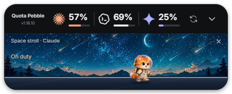
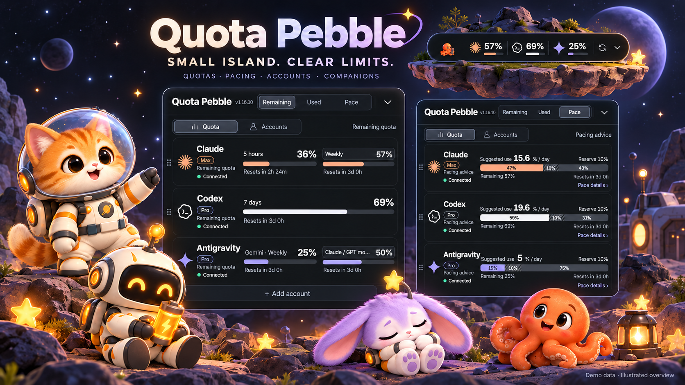
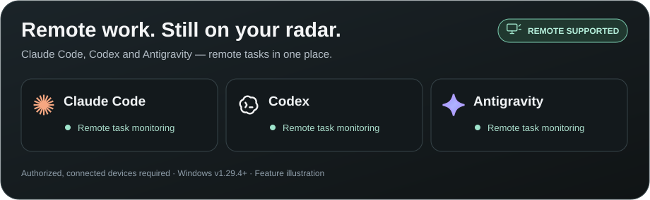
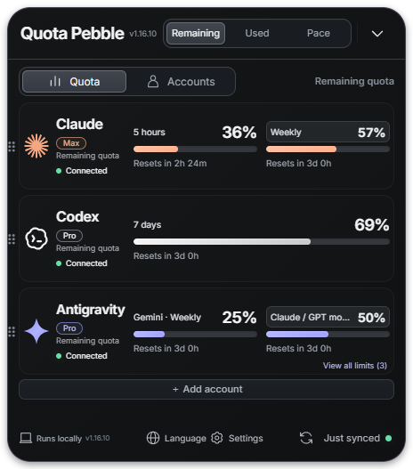
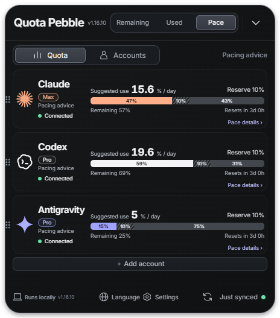
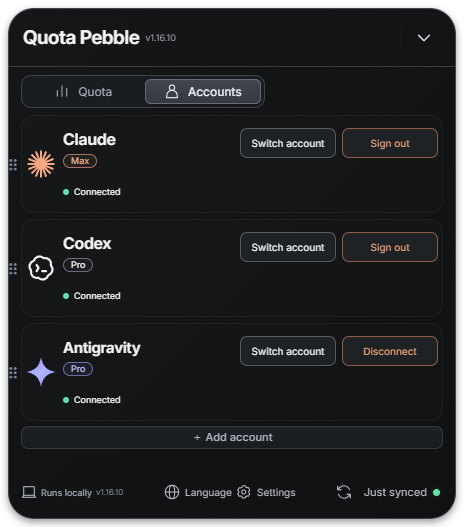
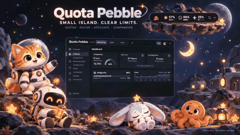
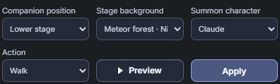

<h1 align="center">Quota Pebble </h1>
<p align="center"><b>Three AI subscriptions. One tiny island.</b><br>See your quota. Pace your day. Keep a little companion nearby.</p>
<!-- project-badges -->
<p align="center">
  <a href="LICENSE"></a>
  <a href="https://github.com/jaylooloomi/quota-pebble/releases/latest"></a>
  <a href="https://github.com/jaylooloomi/quota-pebble/releases/latest"></a>
  <a href="#run-from-source"></a>
  <a href="#desktop-controls"></a>
  <a href="https://github.com/jaylooloomi/quota-pebble/actions/workflows/build.yml"></a>
</p>
<!-- /project-badges -->
<p align="center"><a href="#keep-remote-tasks-on-your-radar"></a></p>

> Windows v1.29.4 adds Antigravity remote task monitoring through Google's official relay ([verification and limits](docs/antigravity-remote-research.md)), alongside Codex and Claude Code Remote Control. Uses existing local sign-in; no CLI, Hooks or private relay. Antigravity remote status refreshes at most once per minute; unsupported states remain unknown. Native macOS ARM64 / Intel release assets remain at v1.28.2.

<p align="center"><a href="https://github.com/jaylooloomi/quota-pebble/releases/latest">Download Windows / macOS</a> · <a href="README.zh-TW.md">繁體中文</a> · <a href="LICENSE">MIT</a></p>

<p align="center"><br><b>Your quotas above. A little companion below.</b><br><sub>Actual app screenshot · demo data</sub></p>



*Illustrated overview updated using actual v1.16.10 screenshots. All pictured percentages are demo data.*

## Keep remote tasks on your radar

**Leave the work on another computer. Keep its progress in sight.** Quota Pebble supports **remote task monitoring for Claude Code, Codex and Antigravity**. Check authorized work-computer tasks from your home desktop, with less window switching and fewer forgotten follow-ups.



| Tool | Remote source | Refresh and status |
|---|---|---|
| Claude Code | Official Remote Control, including connected Claude Desktop Code sessions | About once a minute; running, waiting and idle; unconfirmed states stay unknown |
| Codex | Official relay for already-authorized devices | About every 30 seconds; remote runtime states; disconnects become unknown |
| Antigravity | Google's official Remote Control relay | About once a minute; running and idle verified; other unconfirmed states stay unknown |

AI icons identify the tool, while source labels help identify the computer. When Claude supplies no reliable host name, Pebble shows Remote Control and the account label. Supported completion evidence and stable idle transitions produce different notification bubbles to bring your attention back to work; **idle does not mean successfully completed**.

**Available on Windows v1.29.4 and later.** Source computers must remain running, online and authorized through each tool's official remote feature. Pebble also needs the matching existing sign-in / device authorization. Monitoring has bounded coverage and refresh intervals: it cannot guarantee every device, historical task or brief state transition is captured. Disconnected or stale data stays unknown. Claude support covers Code, not general Chat or Cowork.

[Codex verification and limits](docs/windows-remote-controller-research.md) · [Claude Code verification and limits](docs/claude-remote-tasks.md) · [Antigravity verification and limits](docs/antigravity-remote-research.md)

### Local tasks, too

Read existing local events and native states without launching a CLI, using Hooks or running a private receiver. Inferred local Codex states are labeled; unknown is not running. Identifiable local/remote copies are deduplicated. The three-row scrollable list and optional compact summary keep the island small. [Local monitoring scope](docs/design/task-monitor/LOCAL-SESSIONS.zh-TW.md).

## A quick introduction

AI-generated promotional videos, not recordings of the running app. Video 01 is in English; video 02 temporarily uses Chinese captions. GIF animations are silent.

<p align="center"><br><b>01 · From quota surprises to a clear overview</b></p>

## Use cases

### Claude sign-in in Chrome (source build v1.32.1)

Click Claude sign-in to open a real Chrome window with a Pebble-only profile. Sign in, then close that dedicated window: Pebble verifies the account and organization and syncs quota automatically. No extension or pasted cookie is required; your normal Chrome profiles are untouched. A saved login can be reused after restarting Pebble. Google Chrome must be installed; the flow has been verified on Windows.

Quota refreshes every 15 minutes through Claude's internal web endpoint. This is separate from task monitoring, and website verification, expired sessions or rate limits can still prevent a refresh. Existing working web connections remain connected when upgrading.

| Situation | What you do | What Pebble shows |
|---|---|---|
| Coding with several AI subscriptions | Keep the compact island nearby | Separate Claude, Codex and Gemini / Antigravity quotas |
| Running work on another computer | Open Tasks | Authorized remote tasks from all three tools, with source labels and status reminders |
| Planning work before the reset | Switch to Pacing | Suggested daily usage and an adjustable reserve |
| Using several Claude accounts | Add an account in the panel | Independent account cards; accounts are not added together |
| Needing a quiet desktop | Collapse, drag, or hide to the tray | A small, movable quota display |
| Taking a short break | Preview a companion action | Walking, greetings, feeling low, sleeping, water breaks or recharging |
| A quota service returns 429 | Wait for the next permitted attempt | Cooldown information rather than repeated requests |

## The product, in pictures

These are screenshots of the actual Windows app in isolated demo mode, not live customer accounts. Demo Gemini rows do not demonstrate every Antigravity quota group.

### A glance, then the details




Switch Remaining / Used / Pacing without changing the provider order. Drag cards to reorder, choose which services are visible, and inspect additional model windows when the source supplies them. Compact multi-account displays cycle individual accounts; their quotas are never summed.

### Pace your usage



The default reserve is **10% of total quota**. Guidance divides the remaining usable quota by the actual time until reset; it is a planning suggestion, not a provider-enforced daily allowance. Open pacing details to adjust the reserve and quota window.

### Inspect usage trends

Open **Usage trends** on a quota card to expand a local history chart without moving its original controls. Choose a quota window and the last 24 hours, 7 days or 30 days. The chart always shows **used quota %**, separates resets and data gaps, and never estimates token counts. Recording begins with successful readings after this feature is installed; no past history is invented. History stays local for up to 90 days / 50 MiB, and can be cleared in settings. Viewing charts makes no additional provider requests.

### Keep account controls separate



Claude supports additional independent account profiles. Claude and Codex expose account switching and sign-out controls. Antigravity uses its local account and supports switching/disconnection; disconnecting Pebble does not necessarily sign out of Antigravity itself.

### Small companions, your choice of position

<p align="center"><br><b>02 · Quotas, pacing and little companions</b><br><sub>AI-generated promotional animation · Chinese captions · silent GIF</sub></p>




Actual pet settings: Preview is temporary; Apply saves the selected character, location and background.

Four soft 3D companions: an astronaut cat, a mechanical robot, a star rabbit and an octopus. Choose the upper area or lower stage, then preview an action in that position. Upper-area companions walk for 8–14 seconds and perform an action for 8–14 seconds before walking again. Actions rotate; water breaks have a 20-minute interval. The lower stage also supports click-to-feed interaction. Stage backgrounds include Meteor Forest plus day/night variants of Cloud Islands, Sakura Garden, Coastal Lighthouse, Snowy Cabin and Space Greenhouse. Dragging the title pauses and resumes the current action.

Pet growth and token-based XP are not implemented.

## Get started

1. **Download** from [Releases](https://github.com/jaylooloomi/quota-pebble/releases/latest): Windows x64 portable EXE, macOS Apple Silicon (`arm64`) ZIP, or macOS Intel (`x64`) ZIP. Verify downloads with `SHA256SUMS.txt`. Run the EXE on Windows; on Mac, unzip and move `Quota Pebble.app` to Applications. Windows is unsigned; Mac builds are ad-hoc signed, without Developer ID or Apple notarization. For first-launch restrictions, follow [Apple’s instructions](https://support.apple.com/102445).
2. **Connect** the provider accounts you want to monitor, using the table below.
3. **Choose your view**: quotas or accounts, Remaining / Used / Pacing, visible services, language and pet position.

| Provider | Requirements and connection |
|---|---|
| Claude | Install the official [Claude Code CLI](https://code.claude.com/docs/en/setup). Click Login: Pebble first opens `https://claude.ai/new`. Sign in to the correct account, return and click **Signed in to the correct account — continue**. Complete browser authorization and paste a code into Pebble only if prompted. No interactive Claude terminal or Hello is required for quota polling. |
| Codex | Install the official [Codex CLI](https://developers.openai.com/codex/cli) and sign in with the ChatGPT subscription you want to monitor. |
| Gemini / Antigravity | Keep Antigravity running and signed in for its local quota service. These are Antigravity allocations, not the Gemini website's usage meter. Enterprise Code Assist is an alternative source in settings. |

**Browser sign-in, OAuth authorization and quota synchronization are separate steps.** Signing in successfully does not guarantee the quota endpoint will accept a request immediately. Opening `/new` prepares the browser login; it does not reset rate limits.

## Refresh behavior and limits

- Claude's normal per-account quota interval is **at least 10 minutes**. Manual refresh shares that interval. Completed authentication may trigger one synchronization, while an active 429 cooldown still takes priority.
- Codex and Gemini normally refresh about every two minutes. Disabled sources stop polling.
- Claude uses local official-CLI credentials to query the OAuth usage endpoint. It does **not** currently use statusline snapshots. The endpoint can change or return 429 even when normal Claude conversations work.
- Cooldowns survive restart. Do not repeatedly sign in to resolve a 429. A retry time means the app may try again, not that the server guarantees recovery.
- Model-specific limits and reset times are displayed only when supplied. Unknown values are not invented. Antigravity Claude/GPT pools remain separate from independent subscription cards.
- The numbers are **subscription quotas**, not network traffic, token counts, API spend or context-window percentages.

## Desktop controls

| Control | Behavior |
|---|---|
| Title drag / screen edges | Move the island; nearby work-area edges can snap into alignment |
| Quota / Accounts | Separate readings from account management |
| Settings | Visible services, sources, always-on-top, launch at login, pets and more |
| Language | Traditional Chinese, English, Japanese and Korean |
| Refresh | Recheck when the account's schedule/cooldown permits |
| `Ctrl / Command + Alt + Q` | Show or hide the app |
| Tray menu | Show, hide or quit |

Always-on-top applies to ordinary desktop windows; Windows secure desktop and exclusive fullscreen can take precedence.

## Run from source

```sh
npm ci
npm run build
npm start
```

Node.js 24 is recommended. Electron + TypeScript; the UI is HTML/CSS/JavaScript. Windows is tested locally. macOS 15 Apple Silicon and Intel builds pass native CI unit tests, packaged-app launch, four-language UI, pet preview/apply and background persistence tests. Mac tests use demo data; live provider login and quota retrieval have not been validated on Mac. Linux has a package target but no binary in this release.

```sh
npm test
npm run test:coverage
npm run dist:win
```

v1.16.5: **117 unit tests passed** during release preparation. The portable application was observed running with the expected version; Playwright's attachment to the self-extracting launcher timed out and is not reported as a pass. Tests and demo screenshots do not prove that every provider account or service is available.

Diagnostic logs record sanitized state transitions, error categories and retry times. They should not contain tokens, cookies or authorization codes. See [visual provenance](docs/readme-v1.16.10/PROVENANCE.md) for the screenshots and generated artwork.

## License

Released under the [MIT License](LICENSE). You are welcome to use, modify, share and use this project commercially. **When redistributing the software or substantial portions of it, you must retain the original copyright notice and the complete MIT permission notice.** Third-party assets and dependencies remain subject to their own licenses; see [third-party notices](THIRD_PARTY_NOTICES.md).

If Pebble becomes part of your own work, a credit in your README, About page or article would also be appreciated. This is a friendly request, not an additional MIT license condition:

> Quota Pebble, created by Arthur Wang ([@jaylooloomi](https://github.com/jaylooloomi)), licensed under MIT. [Original project](https://github.com/jaylooloomi/quota-pebble).

## Meet the author

Hi, I'm Arthur Wang (jaylooloomi), the creator of Quota Pebble. I enjoy turning small everyday frustrations into useful, playful tools, and I'm always happy to meet people with similar interests.

Whether you have feedback, a feature idea, a technical question, or simply want to say hello, you're welcome to connect through [GitHub](https://github.com/jaylooloomi), [Issues](https://github.com/jaylooloomi/quota-pebble/issues), or a pull request. I hope this little tool makes your work easier—and gives us a chance to exchange ideas and become friends.
