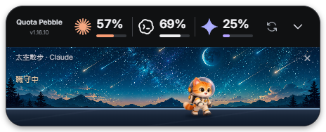
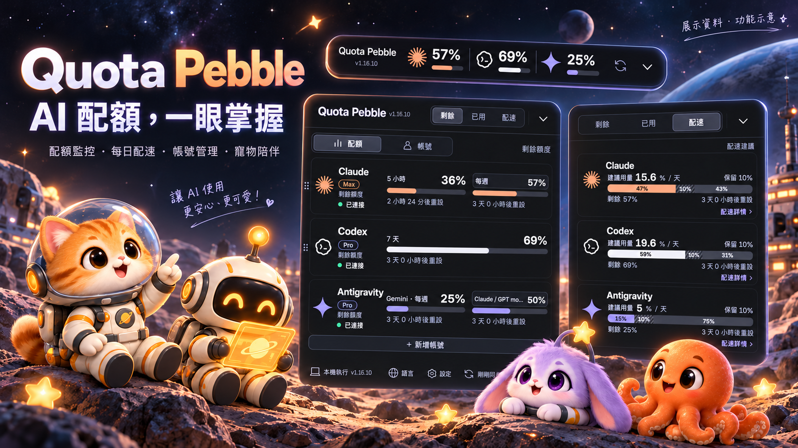
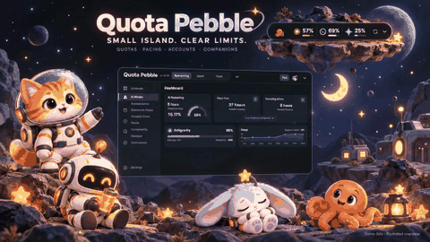
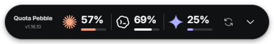
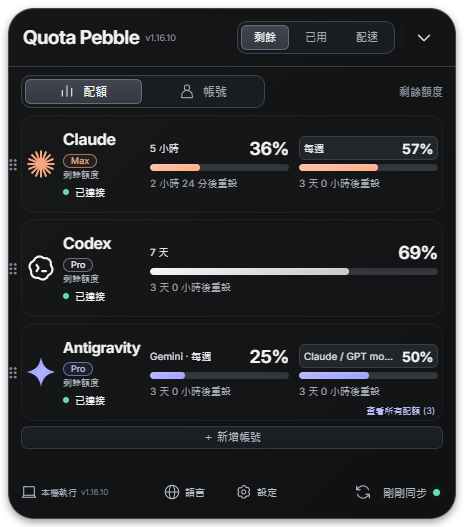
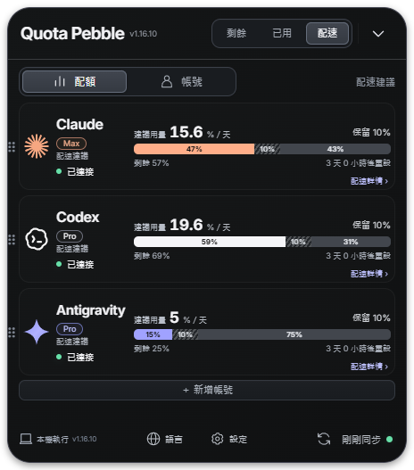
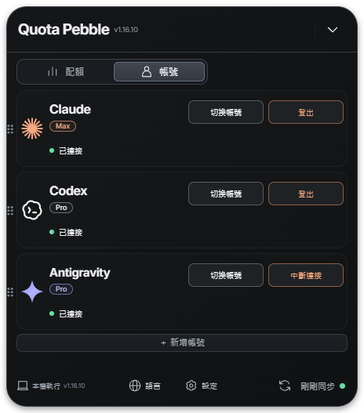
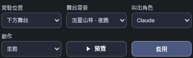

<h1 align="center">Quota Pebble </h1>
<p align="center"><b>三家 AI 訂閱，一顆桌面小島。</b><br>額度一眼掌握，工作有配速，桌上有陪伴。</p>
<!-- project-badges -->
<p align="center">
  <a href="LICENSE"></a>
  <a href="https://github.com/jaylooloomi/quota-island/releases/tag/v1.16.10"></a>
  <a href="https://github.com/jaylooloomi/quota-island/releases/latest"></a>
  <a href="#從原始碼執行"></a>
  <a href="#桌面操作"></a>
  <a href="https://github.com/jaylooloomi/quota-island/actions/workflows/build.yml"></a>
</p>
<!-- /project-badges -->
<p align="center"><a href="https://github.com/jaylooloomi/quota-island/releases/latest">下載 Windows / macOS</a> · <a href="README.md">English</a> · <a href="LICENSE">MIT</a></p>

<p align="center"><br><b>上面掌握額度，下面有個小夥伴。</b><br><sub>App 實際截圖 · 展示資料</sub></p>



*以 v1.16.10 實際截圖更新的功能介紹圖；圖片中的百分比均為展示資料。*

## 10 秒認識 Quota Pebble

中文語音／字幕 · AI 生成介紹影片，非 App 實際操作錄影。點擊動態預覽，可開啟原始 MP4 有聲版本。

<p align="center"><a href="docs/videos/intro-01-zh-TW.mp4"></a><br><b>01 · 告別額度突然見底</b><br><sub>▶ 點擊觀看有聲影片 · 中文</sub></p>

<p align="center"><a href="docs/videos/intro-02-zh-TW.mp4"></a><br><b>02 · 額度、配速與桌面小夥伴</b><br><sub>▶ 點擊觀看有聲影片 · 中文</sub></p>

## 使用情境

| 什麼時候 | 怎麼使用 | 你會看到 |
|---|---|---|
| 同時使用多家 AI 寫程式 | 把收合小島放在桌面 | Claude、Codex、Gemini／Antigravity 各自的額度 |
| 想把額度用到重置前 | 切到「配速」 | 每日建議用量與可調整的保留比例 |
| 有多個 Claude 帳號 | 新增獨立帳號 | 各帳號分開顯示，不相加或平均 |
| 不想讓監控視窗占空間 | 收合、拖曳或隱藏到系統匣 | 小巧的桌面膠囊 |
| 想有桌面小夥伴 | 選角色、位置與預覽動作 | 走路、打招呼、垂頭喪氣、睡覺、喝水、補充電力 |
| 遇到配額服務限流 | 等待允許重試的時間 | 明確冷卻狀態，而不是一直送出查詢 |

## 看圖認識功能

以下為目前 Windows 打包版在獨立展示模式下的實際截圖，不含真實帳號資訊。展示版 Gemini 卡片並不代表所有 Antigravity 配額群組。

### 收合看重點，展開看細節





切換「剩餘／已用／配速」，保留供應商排列。拖拉卡片調整順序，也能在設定隱藏不想顯示的服務。來源提供模型細分時，可再展開查看。收合的多帳號數值會輪播，各帳號額度不會合併。

### 額度也有配速員



預設保留**總配額的 10%**，再依距離重置的實際時間計算每日建議用量。這是規劃建議，不是服務端的每日上限；「配速詳情」可調整保留比例及計算窗口。

### 帳號管理獨立分頁



支援新增獨立 Claude 帳號。Claude、Codex 提供切換帳號與登出；Antigravity 使用本機帳號，提供切換與中斷連接。中斷 Quota Pebble 連接不等於將 Antigravity 本身登出。

### 寵物常駐上方，也能在下方陪伴




實際寵物設定：預覽暫時播放；套用保存角色、位置與背景。

太空貓、機器人、星兔、小章魚，統一柔順 3D 風格。選「上方區域」或「下方舞台」，預覽會跟隨所選位置。上方寵物走路 8～14 秒，再執行動作 8～14 秒；動作打散輪替，喝水保留 20 分鐘間隔。下方舞台支援點擊投食。舞台背景可選流星山林，以及雲海浮島、櫻花庭園、海岸燈塔、雪山木屋、太空溫室的日夜版本。拖動標題時暫停，放開後接續原動作。

寵物成長、Token 經驗值尚未實作。

## 三步開始

1. **下載**：[Releases](https://github.com/jaylooloomi/quota-island/releases/latest) 提供 Windows x64 免安裝 EXE、macOS Apple Silicon（`arm64`）及 Intel（`x64`）ZIP，可使用 `SHA256SUMS.txt` 驗證。Windows 直接執行；Mac 解壓縮後將 `Quota Pebble.app` 移至「應用程式」。Windows 未簽章；Mac 為 ad-hoc 簽署，尚無 Developer ID 與 Apple 公證。首次開啟限制請依 [Apple 官方說明](https://support.apple.com/102445) 操作。
2. **連接帳號**：依下表完成各來源設定。
3. **選擇顯示方式**：配額／帳號、剩餘／已用／配速、服務顯示、語言與寵物位置。

| 服務 | 需求與登入方式 |
|---|---|
| Claude | 安裝官方 [Claude Code CLI](https://code.claude.com/docs/en/setup)。按登入後，先開 `https://claude.ai/new`；在瀏覽器登入正確帳號，再回 App 按「已登入正確帳號，繼續授權」。完成瀏覽器授權；若要求授權碼，貼回 App。配額查詢不需啟動互動式 Claude 終端機或 Hello。 |
| Codex | 安裝官方 [Codex CLI](https://developers.openai.com/codex/cli)，登入要監控的 ChatGPT 訂閱帳號。 |
| Gemini／Antigravity | 保持 Antigravity 開啟並登入，讀取它的本機配額服務；這不是 Gemini 網站用量。企業 Code Assist 可在設定選擇替代來源。 |

**網頁登入、OAuth 授權、取得配額是三個不同階段。** 登入完成不代表配額端點立即接受查詢；`/new` 是先準備正確的網頁登入狀態，不會重置限流。

## 同步頻率與限制

- Claude 一般情況下每帳號**至少 10 分鐘**查一次，手動刷新也共用間隔。完成授權可觸發一次同步，但仍遵守現有 429 冷卻。
- Codex、Gemini 正常約每兩分鐘更新；停用來源會停止查詢。
- Claude 沿用本機官方 CLI 憑證查詢 OAuth usage 端點，**目前不使用 statusline 快照**。該端點可能變動，也可能在對話可用時回傳 429。
- 冷卻紀錄跨重啟保留。429 不要靠反覆登入解決；重試時間只代表允許再試，不保證服務端已恢復。
- 模型細分與重置時間只顯示來源實際提供的資料，不會補造未知值。Antigravity 的 Claude／GPT 共用池不會混入獨立訂閱卡片。
- 這些數字是**訂閱配額**，不是網路流量、Token 統計、API 帳單或上下文使用率。

## 桌面操作

| 控制 | 功能 |
|---|---|
| 拖動標題／靠近螢幕邊緣 | 移動小島，靠近工作區邊緣時貼齊 |
| 配額／帳號 | 分開查看用量與管理帳號 |
| 設定 | 顯示服務、來源、保持最上層、開機啟動與寵物 |
| 語言 | 繁中、英文、日文、韓文 |
| 重新整理 | 在帳號間隔及冷卻允許時更新 |
| `Ctrl／Command + Alt + Q` | 顯示或隱藏 |
| 系統匣 | 顯示、隱藏、結束 |

保持最上層適用一般桌面視窗，Windows 安全桌面與獨佔全螢幕仍可能優先顯示。

## 從原始碼執行

```sh
npm ci
npm run build
npm start
```

建議 Node.js 24。使用 Electron、TypeScript 與 HTML/CSS/JavaScript。Windows 為本機實測平台。macOS 15 Apple Silicon 與 Intel 已通過原生 CI 單元測試、打包 App 啟動、四語系介面、寵物預覽／套用及背景保存測試；Mac 測試使用展示資料，尚未在 Mac 驗證真實服務登入與配額讀取。Linux 有打包目標，本次 Release 未提供成品。

```sh
npm test
npm run test:coverage
npm run dist:win
```

v1.16.5 發布準備時 **117 項單元測試通過**。免安裝版實際啟動且版本確認正確；Playwright 連接自解壓啟動器逾時，未算通過。測試與展示截圖不代表所有帳號及外部服務均可用。

診斷紀錄包含經篩選的狀態、錯誤類型及重試時間，不應記錄 Token、Cookie 或授權碼。[圖片來源與製作說明](docs/readme-v1.16.10/PROVENANCE.md)。

## 授權

本專案採用 [MIT License](LICENSE)，歡迎使用、修改、分享與商業應用。**再散布本軟體或其重要部分時，必須保留原作者的著作權聲明及完整 MIT 授權聲明**；相關第三方素材與依賴仍須遵守各自的授權，詳見 [第三方聲明](THIRD_PARTY_NOTICES.md)。

若你將它用於自己的作品，也歡迎在 README、關於頁面或介紹文章附上以下出處，讓更多人找到原始專案（這是額外的友善邀請，不增加 MIT 以外的授權限制）：

> Quota Pebble，由 Arthur Wang（[@jaylooloomi](https://github.com/jaylooloomi)）創作，採 MIT 授權。[原始專案](https://github.com/jaylooloomi/quota-island)。

## 關於作者與交流

嗨，我是 Arthur Wang（jaylooloomi），Quota Pebble 的作者。我喜歡把工作中的小困擾做成實用又有趣的工具，也很樂意認識有相同興趣的朋友。

無論是使用心得、功能點子、技術討論，或只是想打聲招呼，都歡迎透過 [GitHub](https://github.com/jaylooloomi)、[Issues](https://github.com/jaylooloomi/quota-island/issues) 或 Pull Request 和我交流。希望這個小工具不只讓工作順一點，也能成為我們認識彼此的起點。
