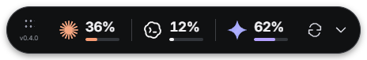
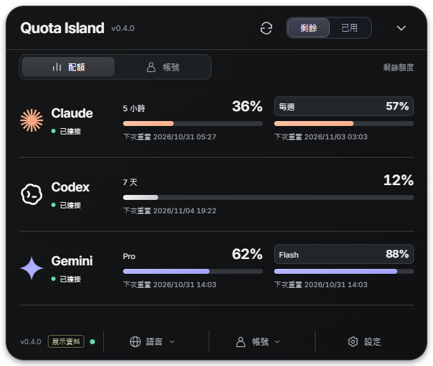
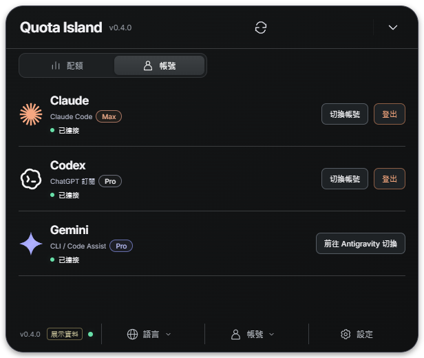

<h1 align="center">Quota Pebble 🏝️</h1>

<p align="center"><b>三家 AI 訂閱，一座小島掌握。</b><br>Claude、Gemini、Codex 還剩多少，一眼就知道。需要細節再展開，其他時間專心寫程式。</p>

<p align="center">
  <a href="LICENSE"></a>
  
  
  
  <a href="docs/test-coverage.md"></a>
  <a href="README.md"></a>
</p>

<p align="center"><br><sub>實際 App 截圖，使用展示資料；圖中百分比不代表即時帳號配額。</sub></p>

## 使用情境

| 情境 | 你怎麼用 | 小島幫你看什麼 |
|---|---|---|
| 🧑‍💻 **寫程式寫到忘我** | 讓精簡膠囊常駐視窗上方 | 剩餘配額，一眼掌握 |
| 🔄 **在幾家 AI 之間切換** | 點一下展開 | 各家窗口與重設時間 |
| 🔐 **連接帳號** | 完成授權流程 | 連接進度，完成後自動同步 |
| 🧩 **常用的工具想放前面** | 拖曳服務圖示或卡片標題 | 兩個視圖共用排序，重開仍保留 |
| ⏳ **服務限制查詢頻率** | 等待冷卻倒數 | 明確的限流狀態與自動重試 |
| 🖥️ **桌面已經夠擠了** | 收成小膠囊，或藏到系統匣 | 需要時再叫出來 |

## 開始使用

**需要：** 建議 Node.js 24 LTS、npm，以及欲監控服務的官方工具。Windows 已於本機測試；macOS、Linux 有建置目標，仍待實機驗證。

### 1. 啟動 App

```sh
git clone https://github.com/jaylooloomi/quota-island.git
cd quota-island
git switch design/original-dark-00
npm ci
npm start
```

上述分支包含本頁的小尺寸原版深色介面。想用執行檔？執行 `npm run dist:win`，Windows 便攜版會產生在 `release/`。目前尚未提供已發布的安裝檔下載。

### 2. 連接你的工具

| 服務 | 先安裝／開啟 | 如何連接 |
|---|---|---|
| **Claude** | [Claude Code](https://code.claude.com/docs/en/setup) | 使用 App 的登入入口；若出現授權碼流程，將瀏覽器提供的碼貼回 App。也可沿用本機 CLI 授權。 |
| **Gemini 個人版** | 已登入且持續執行的 Antigravity | 直接讀取其本機服務提供的 Gemini 模型配額。 |
| **Gemini 企業版** | Code Assist 帳號 | 在設定切換 Google 來源為 **Code Assist**，再完成 Google OAuth。 |
| **Codex** | [Codex CLI](https://developers.openai.com/codex/cli) | 使用 App 的登入入口，或沿用本機 ChatGPT 訂閱登入。 |

授權完成後，App 會自動顯示並同步配額。不必自己去用量頁查看；只登入服務網站本身不等於已授權此 App。

### 3. 繼續專心工作

點配額或箭頭展開，拖左側把手移動整座島，拖服務圖示或卡片標題調整順序。

<p align="center"><br><sub>原版深色 · 收合視窗 464 × 76 · 展開視窗 616 × 520，包含透明邊距。使用展示資料。</sub></p>

## 日常操作

底欄分工：**語言**原地開啟四語選單；**同步狀態**查看三家同步時間、失敗原因與
重試倒數，並可重新同步；**設定**管理偏好，關閉後回到原本的配額／帳號分頁。
選單同時只開一個，點外部或按 Esc 關閉；帳號管理集中在上方「帳號」分頁。

0.6.2 採用「精簡雙層島」：膠囊迷你進度條、精簡服務列、明顯版本號，以及**配額／帳號**分頁。
在帳號頁可切換或登出 Claude、Codex；登出須確認，也會影響本機官方 CLI 使用的帳號。
Gemini 個人版則透過專用按鈕開啟 Antigravity，在其中管理 Google 帳號。

<p align="center"><br><sub>展示帳號狀態；不推測或編造 email。</sub></p>

**多語系：** 設定 → 語言 → 繁體中文／English／日本語／한국어。
切換立即生效，重新啟動仍會保留；系統匣、配額倒數、登入操作與輔助標籤也會同步切換。

| 操作 | 功能 |
|---|---|
| 剩餘／已用 | 切換百分比顯示，並記住選擇 |
| 重新整理 | 5 秒防連點後可更新，仍尊重服務冷卻時間 |
| 連接狀態 | 管理帳號授權、查看資料來源 |
| 聚焦精簡服務後 `Alt + ← / →` | 鍵盤排序 |
| 小卡左側把手／聚焦後 `Alt + ↑ / ↓` | 拖拉或鍵盤排序；顯示來源實際提供的訂閱方案 |
| `Esc` | 依序關閉連接詳情、設定，再收合面板 |
| `Ctrl / ⌘ + Alt + Q` | 隱藏或顯示 App |
| 設定／系統匣 | 調整置頂、來源、用量提醒、隱藏或結束 |

背景每兩分鐘更新。停用來源後停止查詢。服務的 `Retry-After` 冷卻時間會保留到下次啟動，手動更新也不會繞過。未知配額不會當成零，舊資料也會明確標示。

每個配額窗口直接顯示「幾天／幾小時後重置」，依所選語言呈現；滑鼠移上去可查看
完整日期、時間與電腦時區。上游未提供時間時會明確標示，不自行推算。
配速建議目前是[五方案概念稿](docs/design/pacing-proposals/README.md)，尚未加入 App。

## 數字從哪裡來

Claude 主卡只顯示本次工作階段與每週所有模型；Fable 等模型專屬限制移至
「查看模型配額」詳情，持續背景更新並保留重置時間。模型與所有模型額度不能相加。

Antigravity 現在優先讀取 `RetrieveUserQuotaSummary` 群組摘要，包含 Gemini 群組、
Claude／GPT 群組各自的每週與 5 小時限制，以及 Argon 等模型專屬限制。
主卡顯示最吃緊的兩項，並以「查看所有配額」標明總數；點開可看每個回傳群組。
這裡的 Claude／GPT 都屬於 Antigravity，不會混入獨立訂閱卡片。較舊的本機服務才
回退至其實際提供的 Gemini 模型資料，不會編造缺少的群組額度。

這裡顯示的是**訂閱配額與重設窗口**，不是網路流量、API 帳單或本機 token 累計。

| 卡片 | 資料來源 | 要分清楚的地方 |
|---|---|---|
| Claude | 本機 Claude Code 授權 → OAuth 用量端點 | 用量端點並非穩定公開 API |
| Gemini | 預設 Antigravity 本機服務，也可選企業 Code Assist | 不是 Gemini 網頁版配額；Antigravity 的 Claude／GPT 額度不會混入另外兩張卡片 |
| Codex | 官方 `codex app-server` → `account/rateLimits/read` | 依伺服器實際窗口顯示，不假設所有方案限制相同 |

## 測試與實際驗證

| 檢查 | 最近一次本機結果 |
|---|---|
| 核心測試 | **69 項通過** |
| 納入統計的 Node 模組 | **行 91.91% · 分支 88.63% · 函式 91.26%** |
| Windows 打包成品 | 桌面操作、排序、畫面檢查通過 |
| 授權整合 | 模擬上游回應，搭配真實本機 IPC／回呼／子程序路徑 |
| 真實帳號 | 曾驗證 Gemini、Codex 可讀取；Claude 最近一次真實查詢回傳 HTTP 429 |
| macOS／Linux | 已有建置目標與 CI matrix，尚無本機實機驗證 |

覆蓋率只統計 Node 測試載入的模組，**不是整個 App 的覆蓋率**。Electron 進入點、來源整合與 renderer 操作另有測試；Antigravity 原生程序發現仍有單元測試缺口。詳見[覆蓋範圍](docs/test-coverage.md)，遠端執行狀態請看 [GitHub Actions](https://github.com/jaylooloomi/quota-island/actions)。

<details>
<summary><b>執行測試與打包</b></summary>

```sh
npm run test:coverage  # 重建、核心測試、覆蓋率門檻
npm run test:desktop   # 尺寸、操作、sandbox、原生加密
npm run test:auth      # 授權流程與自動同步畫面
npm run test:order     # 拖拉、鍵盤排序、重啟保留
npm run test:design    # 裁切、重疊、比例、狀態、無捲動版面
npm run dist:win       # Windows 便攜執行檔
npm run dist:mac       # macOS ZIP
npm run dist:linux     # Linux AppImage
```

CI 門檻：納入統計的模組至少行 85%、分支 80%、函式 85%，並上傳報告。Windows 成品尚未簽章；macOS 成品尚未簽章或公證。

不查詢服務的展示模式：先 build，再執行 `npx electron . --demo`。`npm run check:live`、`npm run check:accounts`、`npm run test:live` 會查詢真實本機帳號，與模擬資料測試分開。

</details>

<details>
<summary><b>授權資料與本機儲存</b></summary>

Claude、Codex 授權仍由官方 CLI 管理，App 不自行輪替其 refresh token。企業 Google OAuth 使用 Electron 原生 `safeStorage` 加密，不允許明文 fallback。Token 不傳到 renderer，也不寫進偏好檔或測試報告。

| 平台 | App 資料目錄 |
|---|---|
| Windows | `%APPDATA%/quota-island` |
| macOS | `~/Library/Application Support/quota-island` |
| Linux | `~/.config/quota-island` 或系統設定的 XDG 路徑 |

Linux 需要可用的 Secret Service。若只想移除 App 的企業 Google 授權副本，先結束應用，再刪除資料目錄中的 `gemini-session.bin`。關閉來源只停止監控，不會登出官方 CLI。

</details>

## 常見問題

**Gemini 為什麼透過 Antigravity？**  
個人版來源讀取 Antigravity 的 Gemini 模型配額，企業 Code Assist 是另一個明確區分的設定。詳見[來源研究](docs/research.md)。

**Claude 為什麼顯示倒數，沒有百分比？**  
最近一次真實查詢被服務限流。App 會顯示原因，冷卻後自動重試；不會編造配額，也不會把限流當成登出。

**可以切換之前畫的五款風格嗎？**  
那些是[設計探索稿](docs/design/style-explorations/00-six-styles-comparison.png)。目前實作的是原版深色，尚無主題切換器。

**這是三家官方提供的 App 嗎？**  
不是。這是獨立桌面工具，服務名稱歸各自權利人所有。非公開配額介面可能隨上游變更。

## 貢獻

其他撤銷授權、操作與排錯細節請見[完整操作筆記](docs/usage-guide.zh-TW.md)。

歡迎 issue 與 PR。提交前請執行覆蓋率檢查與變更相關的桌面測試。回報問題時附上作業系統，並區分展示資料與真實服務回應。

README 呈現參考 [i-want-to-sleep](https://github.com/jaylooloomi/i-want-to-sleep)：精簡介紹、圖片、情境表格與可收合的技術細節。

## 授權

[MIT](LICENSE)。字型等隨附素材請見[第三方聲明](THIRD_PARTY_NOTICES.md)。

Antigravity 帳號操作：**切換帳號**會開啟官方 App、清除舊配額，偵測到不同帳號後自動更新。**中斷連接**只停止 Quota Pebble 的監控並保存狀態，不會登出 Antigravity。安裝版 2.27.0 尚未驗證可用的外部登出入口，因此未提供直接原生登出。

### 配速模式
右上切換 **剩餘／已用／配速**，共用相同橫向卡片布局。預設保留總配額的 5%，依選定窗口的實際重置倒數平均分配餘額；不足一天則顯示每小時建議。詳情可切換配額窗口、調整保留百分比，並保存設定。資料過期、重置時間缺失或已過、監控暫停時不提供建議。這是平均預算建議，不是額外配額或用量上限。

配速詳情會在所選服務卡片下方展開，一次只展開一家；其他卡片保持可見，視窗維持固定寬度並依內容加高。再點同一列即可收起並恢復高度。

### 早安 Hello

設定頁可開關「早安 Hello」及調整執行時間，預設每天台灣時間 08:00，涵蓋所有已連接且啟用的 Claude 帳號。官方 CLI 會用 Haiku 發送一次簡短 Hello，消耗少量配額，嘗試開啟新的 5 小時視窗；已有進行中的視窗就略過，不能提早重置，也不會增加每週額度。App 必須執行中；睡眠或關機時不會喚醒，排程後 4 小時內啟動可補送。

每個本機帳號每天最多嘗試一次，送出前先持久化紀錄；失敗、逾時或重啟後結果不明時不自動重送，避免重複消耗。授權失效、限流、過期配額或額度已滿時不送。設定頁顯示結果，確認後再同步配額；無工具、MCP、專案內容或對話歷史，亦不使用 API Key 後備。功能測試採用模擬 CLI，未為測試額外消耗真實帳號額度。

規則參考：[Claude 用量限制](https://support.claude.com/en/articles/11647753-how-do-usage-and-length-limits-work)、[官方 CLI 參數](https://code.claude.com/docs/en/cli-reference)。

### 多個 Claude 帳號
卡片清單底部的 **＋ 新增帳號** 可命名並登入其他 Claude 帳號。每個帳號在 App 本機資料夾內使用獨立的官方 Claude Code 設定目錄；配額、冷卻、配速、顯示、排序與登出互相隔離。移除新增帳號只會清除該帳號的本機設定，授權不會傳給 renderer 或存入帳號清單。請在瀏覽器選擇要新增的帳號。收合列保持固定大小，每 5 秒輪播可見的 Claude 帳號，小標顯示 1/2、2/2。滑鼠移入暫停輪播，提示帳號名稱、週額度、重置時間與錯誤；點擊切換下一個帳號，拖曳仍調整供應商順序。輪播只讀取已取得的資料，不會額外查詢配額；展開後可查看各帳號卡片。本版先提供 Claude 多帳號，未提供額外 Codex、Antigravity 帳號設定。

拖到螢幕邊緣或角落附近會自動吸附到工作區邊界；展開、收合及設定高度改變時維持貼齊。拖離邊緣即可解除吸附，重啟後保留吸附位置。
