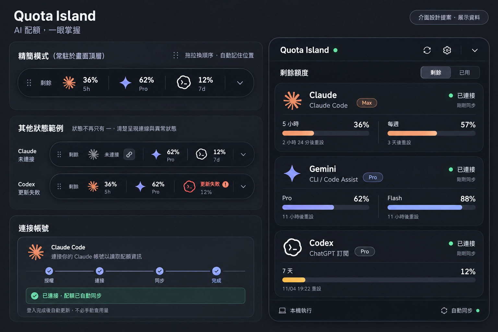

# Quota Island：功能與介面設計提案

日期：2026-10-30。產出方式：內建 imagegen，參考使用者提供的收合動態島截圖。

此圖為設計提案，百分比、方案與重設時間均為展示資料；不是目前執行中 App 的真實帳號狀態。這次工作產出設計圖與規格，沒有把新視覺套入執行中的程式。

## 產品定位

讓使用者在工作時知道 Claude Code、Gemini CLI / Code Assist、Codex 的訂閱配額剩餘多少、何時重設，以及帳號連接／資料更新是否正常。它是一個小型桌面配額儀表。

## 功能範圍

| 功能 | 使用者需要知道／完成的事 | 介面呈現 |
| --- | --- | --- |
| 快速查看 | 三家的主要配額還剩多少 | 收合列顯示「剩餘」、服務圖示、百分比與窗口標籤 |
| 查看細節 | 短期／長期或各模型的配額與重設時間 | 展開卡片顯示服務實際回傳的所有窗口；不憑空補出 5 小時或每週窗口 |
| 連接帳號 | 知道是否真正授權給 App | 未連接 → 等待授權／授權碼 → 連接 → 同步 → 已連接 |
| 自動更新 | 登入成功後直接看到用量 | 完成授權立即讀取配額，更新卡片與收合列；不用到官方頁自行查用量 |
| 問題辨識 | 分清沒登入、登入未完成、沒有配額權限或網路失敗 | 有文字的狀態與原因；不只顯示破折號 |
| 自訂排列 | 依工作習慣安排順序 | 服務圖示與卡片標題可拖拉；共用並保存順序 |
| 桌面操作 | 把工具放在順手位置 | 左側專用拖曳把手移動整座島、置頂、系統匣、快捷鍵 |
| 配額提醒 | 快用完之前有提示 | 剩餘量低時使用琥珀色；通知開關置於設定 |
| 更新管理 | 決定監控哪些服務、知道資料新舊 | 來源開關、同步時間、更新失敗時的舊資料標示 |

Gemini 指 CLI / Code Assist 配額，與 Gemini 網頁版的額度不同。API 金額帳單、網路頻寬、聊天內容與 token 活動統計不包含在這次介面範圍。

## 收合模式

- 保留現在的深色膠囊輪廓，常駐桌面。
- 左側雙點／雙線只用來移動整座島；服務區塊用來排序。
- 「剩餘」必須可見，避免單獨的 88% 被誤認為剩餘或已用。
- 每個服務顯示一個主要窗口，並附上窗口／模型名稱；例如 5h、Pro、7d。實作時依真實資料決定，不依圖中例子寫死。
- 未連接時顯示「未連接」；讀取中顯示短暫載入狀態。
- 更新失敗時顯示警示與舊數字，讓使用者知道它不是最新用量。

## 展開模式

1. 頂部為名稱、同步狀態、重新整理、設定與收合。
2. 全域切換「剩餘／已用」，預設剩餘。收合列、百分比和長條必須使用相同模式。
3. 三家各一張卡片，依使用者保存的順序排列。
4. 卡片內容為服務／方案、連接狀態、同步時間、每個配額窗口的數值與重設時間。
5. 進度條的長度必須與百分比一致；剩餘 12% 就只有 12% 的填充。
6. 沒有重設時間時說明未提供，不推算假的精確時間。
7. 底部簡潔顯示本機執行與自動同步狀態。

## 登入與例外狀態

- 未連接：只有清楚的「登入並同步」，不放會讓人誤以為能授權 App 的官方頁面捷徑。
- 等待授權：說明目前等待瀏覽器完成，可重新開啟同一授權頁。
- Claude 授權碼：需要時才顯示輸入欄；送出後清空，不儲存在偏好設定。
- 同步中：授權成功不等於已有配額；必須繼續顯示讀取進度。
- 已連接：僅在配額成功讀取後顯示完成與數字。
- 授權完成但配額失敗：說明是權限、服務或格式問題；避免無限要求重新登入。
- 斷線：保留上次數字並標註舊資料，過期後停止顯示數字。

## 視覺方向

- 近黑底與石墨色表面、細邊框、柔和陰影，保留小型工具的克制感。
- Claude 使用暖杏色，Gemini 使用淡紫色，Codex 使用白色官方圖形。
- 正常連接用小綠點，低剩餘配額用琥珀色，更新失敗才使用警示色。
- 大數字優先、次要資訊弱化但可讀；不用大面積裝飾或複雜側欄。
- 生成圖中的標誌只供概念示意；實作沿用現有官方 SVG 資產，不從生成圖裁切或重繪商標。

## 驗收重點

- 用戶一眼能辨識數字代表剩餘或已用。
- 收合列與展開卡片順序一致，重開後保留。
- 登入成功能自動更新兩個視圖，不靠手動刷新。
- 未連接、授權中、同步中、沒有權限與網路故障可明確區分。
- 各家實際窗口完整呈現，沒有回傳的窗口不自行補出。
- 所有實作百分比、長條與重設時間以真實服務資料為準。

繪圖提示詞：見 [quota-island-v2.prompt.txt](quota-island-v2.prompt.txt)。
