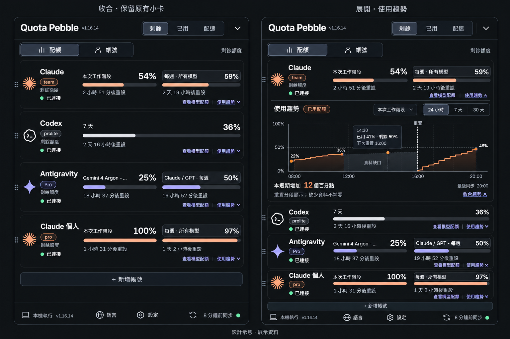

# Quota Pebble 使用趨勢規格

日期：2026-11-02  
狀態：v1.17.0 已實作，本機驗證通過；驗證結果見 VERIFICATION.zh-TW.md  
適用：Windows、macOS、Linux；繁體中文、英文、日文、韓文

## 1. 目的與範圍

讓使用者觀察各帳號、各配額窗口的消耗變化，辨識用量增加的時段，並查看重置與資料缺口。沿用現有同步結果，不增加服務呼叫，不變動目前的小卡基本布局。

第一版包含本機歷史保存、向下展開的趨勢圖、窗口與時間範圍切換、提示框、重置與缺口處理，以及清除歷史功能。配速參考線、token 數量、跨帳號加總、雲端同步與預測耗盡時間不屬於第一版。

## 2. 設計圖與使用方式

設計圖為 AI 生成示意，使用展示資料。視覺基準是現有 App：近黑背景、細灰框、圓角、緊湊文字、淡紫互動元件，以及 Claude 橘色、Codex 白色、Antigravity 紫色。

設計圖中以下細節必須依本規格修正，不能直接照圖實作：

- 左右稿中的普通卡片高度不同；正式版展開前後，原有卡片主體高度與元件座標必須一致，只有趨勢區增加高度。
- 圖表的單一橘色點與提示數值不完全吻合；正式版提示框只能顯示實際選中快照，數值與座標一致。
- 「本週期增加 12 個百分點」為示意；正式版必須依第 6 節計算，不能固定顯示，也不能從缺口推測用量。
- 不替原本沒有模型詳情的卡片新增「查看模型配額」。既有詳情入口依資料來源維持原有規則。
- 示意圖對缺口的陰影與重置標記不代表其間有資料；正式版不畫跨缺口或跨週期的連線與面積填色。

## 3. 入口與布局

| 區域 | 規則 |
|---|---|
| 原有標題、分頁與底列 | 保持目前寬度、排列與行為，不新增頂部分頁 |
| 原有小卡 | 左側圖示、名稱、方案與狀態；右側水平配額條，均維持目前位置 |
| 趨勢入口 | 配額分頁中每張卡片右下方的「使用趨勢 ▾」，與既有詳情入口共用底部動作列 |
| 展開位置 | 同一張卡片的主體下方，細分隔線後顯示圖表，不使用彈窗或覆蓋其他內容 |
| 其他卡片 | 僅整張往下移動，內部高度、進度條長度與中心線位置不變 |
| 展開數量 | 一次展開一個帳號；開啟另一帳號時，收合原本帳號 |
| 模型／配速詳情 | 同一時間只保留一個詳情區；切換至其他詳情時收合趨勢 |
| 帳號分頁 | 不顯示趨勢入口；切回配額時可恢復本次工作階段的帳號、窗口與範圍選擇 |

展開區依序顯示：標題「使用趨勢」與「已用配額」標示、配額窗口選單、24 小時／7 天／30 天切換、圖表、統計與最後同步時間、必要狀態說明。

在現有窄視窗內，窗口選單與時間切換採固定兩欄；空間不足時控制列換行，不能壓縮名稱或改變原有卡片布局。圖表高度以約 150–170 CSS px 為初始目標，依實際字級驗證。

視窗高度隨內容增加，先依現有螢幕工作區定位與貼邊規則調整；內容超過可用工作區時，使用內容區捲動，確保標題、底列與操作入口可達，不將內容推出螢幕外。

## 4. 互動

1. 點擊「使用趨勢」展開；再次點擊或按 Escape 收合。Escape 先關閉提示框／下拉選單，再收合詳情。
2. 預設範圍為最近 24 小時。初次開啟時，優先選目前卡片主要配額窗口；沒有該窗口則選資料來源第一個有效窗口。
3. 窗口選項包含目前及保留期間內曾有歷史的窗口。舊窗口標示「僅歷史資料」，不和其他窗口合併。
4. 上方「剩餘／已用／配速」切換不改變趨勢圖指標：第一版固定為「已用配額 %」，持續顯示標示，避免和卡片剩餘比例混淆。
5. 游標停在資料點時顯示時間、已用比例、剩餘比例與該快照的下次重置時間；缺值顯示「未提供」。不對點之間做插值。
6. 支援鍵盤操作：入口具 aria-expanded、aria-controls；圖表可用左右方向鍵移動到相鄰快照，提供相同數值的文字摘要。焦點不因同步而重置。
7. 改名不切斷歷史；切換到不同登入身分會開始新歷史區段。登出不立即刪除紀錄，但不得把後續不同帳號資料接上。
8. 關閉或隱藏服務不再採樣，但保留已有資料；暫停同步後不能持續產生看似新同步的點。

## 5. 資料來源與本機保存

目前 src/model.ts 的 QuotaWindow 提供 id、label、usedPercent、resetsAt；ProviderState 提供 updatedAt、狀態與同步結果。src/poller.ts 與 src/accounts.ts 負責主要及額外帳號讀取。src/diagnostics.ts 是會輪替的診斷紀錄，不能作為可靠的趨勢資料庫。

新增獨立歷史儲存元件，從「成功取得新 reading」事件寫入快照。不得以 UI render、視窗移動、設定變更或每次 publish 作為採樣事件。

每筆窗口樣本至少包含：

| 欄位 | 用途 |
|---|---|
| schemaVersion | 儲存格式遷移 |
| provider、profileId | 區分服務與本機帳號卡片 |
| identityGeneration | 同一卡片更換登入身分時隔離歷史 |
| sourceId、windowId、windowLabel | 區分資料來源與配額窗口；不能靠翻譯後文字作識別 |
| observedAt、sampleId | 真正取得資料的 UTC 時間與去重識別 |
| usedPercent | 0–100 的有效數值，保留來源精度 |
| resetsAt | 來源提供的 UTC 重置時間或 null |
| cycleId、segmentId | 重置週期與可連線區段 |

所有已提供的窗口都保存，不只保存卡片上可見的兩項。來源若有穩定更新時間，保存並用於辨識重複快取；無法辨識快取時，不宣稱來源有即時刷新。

第一版建議使用 userData 下獨立的每日 JSONL 分片，單一寫入佇列，啟動時容忍最後一行中斷，壞行隔離且記錄不含敏感資訊的診斷。90 天保留期限與總量上限 50 MiB 同時生效，超限優先刪除最舊資料；畫面須註明實際可用日期範圍。

快照只保存顯示所需的配額資訊，不保存 token、Cookie、密碼、授權碼、email、提示詞或原始回應。歷史檔以作業系統使用者權限保護，不宣稱額外加密。資料留在本機，不加入 Git 或安裝包。刪除額外帳號時清除該帳號歷史；設定提供「清除全部用量歷史」及明確確認，不影響登入或目前配額。

## 6. 圖表與統計語意

- Y 軸固定 0–100%，標示已用配額；X 軸按實際時間比例排列，以本機時區顯示。跨日顯示日期，提示框含日期與時區偏移，避免夏令時間重複時間混淆。
- 使用階梯線表示快照觀測值，不使用平滑曲線推測實際消耗。採樣之間不代表知道精確使用時刻。
- 不同週期不相連。來源重置時間改變時評估是否跨週期；重置時間微幅修正不能直接當成重置。低值跳回且沒有可靠重置資訊時標示「週期／額度變更」，切斷線段，不肯定宣稱重置。
- 過重置時間仍未取得新資料時，不自動畫出歸零點。下一次成功同步才開始新區段；實際重置時刻不明則標「重置區間」。
- 已知失敗、暫停、休眠或停用形成缺口；超過該來源預期同步間隔三倍仍無新資料也切斷。錯誤前後不能以直線或填色跨越。切換來源、登入身分或窗口識別改變，同樣建立新區段。
- 圖表線色對應供應商，但缺口與重置同時以文字／線型辨識，不只依顏色。
- 「本週期觀測增加 X 個百分點」僅累計所選範圍、最新週期、同一連續區段中相鄰有效樣本的正向差。負向修正不當作使用量；未知區間不推估。存在缺口時附「不含缺口，非完整用量」。完整資料不足時不顯示總量數字。
- 「最後同步」使用成功快照時間，不因重新繪圖而更新。失敗時可展示最後已知資料，但須標記過期／冷卻狀態。
- 為避免每次顯示大量點，長範圍可降採樣；保留區段端點、極值、重置與缺口邊界，不跨區段合併。提示資料與實際繪製點一致。

## 7. 空白與異常狀態

| 狀態 | 呈現 |
|---|---|
| 尚無歷史 | 「開始記錄後會逐步呈現使用趨勢」，不放展示曲線 |
| 只有一筆 | 顯示單點與時間，不畫虛構的線 |
| 範圍內無資料 | 保留控制列，顯示「此時段沒有紀錄」 |
| 未登入／查詢失敗 | 可看既有歷史，顯示當前狀態，不寫入零值 |
| 429 冷卻 | 顯示冷卻資訊與最後成功時間；開啟圖表不觸發刷新 |
| 儲存失敗 | 不影響目前配額顯示，提示歷史未能保存；後續可重試寫入，但不可重發配額查詢 |
| 檔案部分損壞 | 讀取有效紀錄，跳過壞行並記錄診斷，不讓 App 無法啟動 |

## 8. 實作分工與順序

1. 建立歷史儲存與查詢模組：版本、去重、帳號隔離、週期、缺口、保留與清除。
2. 在主要 Poller 與額外帳號成功讀取處接入，避免共用 publish 重複記錄；建立登入身分更換邊界。
3. 透過受限 IPC 提供窗口／時間範圍查詢與清除。Renderer 不直接讀寫檔案；驗證帳號、窗口、時間與最大回傳量。
4. 以 SVG 實作符合現有配色的線圖、提示框、鍵盤與文字摘要，接入小卡下方詳情區與視窗高度計算。
5. 補上中英日韓文、儲存設定、異常狀態，再完成自動化驗證與實機截圖。

## 9. 驗收條件

- 收合時各卡片主體高度、進度條長度與中心線位置相較目前版本無變化；新增入口僅使用底部動作列。展開後其他卡片只向下移。
- 同一卡片展開／收合前後，圖示、名稱、方案、百分比與配額條座標不變；整體寬度固定。
- 展開、換窗口或換時間範圍造成的服務呼叫增量為零。
- 不同 Claude 帳號、同一卡片切換登入身分及不同 Antigravity 配額群組不混線、不混統計。
- 成功的新樣本只保存一次；失敗、過期 reading、設定切換與 render 不產生假快照。相同數值的新成功讀取可保留為平穩觀測點。
- 重置、額度修正、斷線、休眠、停用、資料來源更換均有自動化案例；不出現跨區段連線或虛構零值。
- 重啟後歷史可讀；90 天與容量清理、清除歷史、壞行、寫入失敗及格式遷移有測試。
- 所有提示數值與原始快照一致；統計採百分點、不顯示 token，缺口不被計為已知用量。
- 四語系在目前窄視窗、不同 DPI 與小螢幕工作區驗證，無裁切、重疊或不可達按鈕；鍵盤可操作。
- 隔離展示資料與真實歷史，測試不得讀取或覆寫正式帳號歷史。提供收合、展開、無資料、斷線與重置的實際截圖供驗收。

## 10. 設計產物來源

概念圖由內建 image_gen 產生，參考使用者提供的 v1.16.14 App 截圖。生成方向：保持原始黑色圓角、橫向配額列、供應商配色與頂部／底部控制，並以左右對照展示第一張 Claude 卡片向下展開趨勢圖，包含窗口選擇、時間切換、提示框、重置與缺口。圖中文字與示意數據以本規格及實際快照為準。

## 11. 第一版實作補充

- 統計採「本區段觀測增加」，僅計算最新連續區段；跨缺口或重置的總量不猜測。
- 帳號識別可得時使用本機雜湊識別，未能取得穩定 Claude 身分時採保守區隔，授權更新可能開新區段，避免混入不同帳號。
- 登出與開始登入保留既有歷史；確認身分變更後建立新歷史世代，不將舊身分資料接到新身分。相同可確認身分重新授權時僅切斷連線區段。
- 同一時間只有一個趨勢／配速／模型詳情區；功能剛啟用時只有後續真實快照，不回填過去資料。
