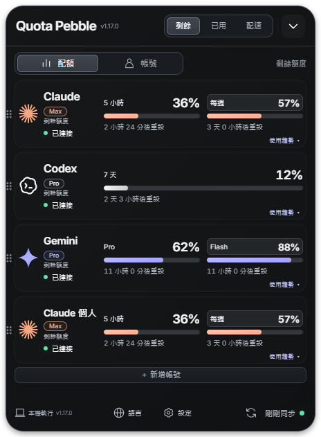
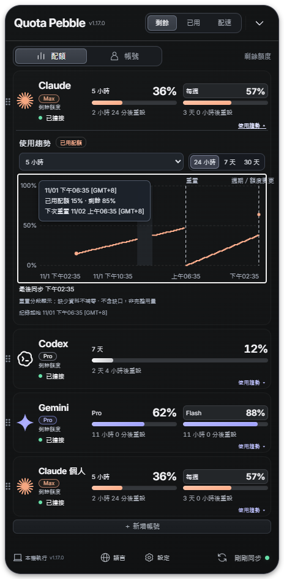

# 使用趨勢驗證紀錄

版本：1.17.0；日期：2026-11-02。以下畫面為真實 Electron 程式的隔離測試資料，不是真實帳號的歷史用量。

## 畫面

其他語言：[English](screenshots/expanded-en.png)、[日本語](screenshots/expanded-ja.png)、[한국어](screenshots/expanded-ko.png)。[無資料狀態](screenshots/empty.png)。

## 本機驗證

| 驗證 | 結果 |
|---|---|
| npm run test:coverage | 124 項單元測試全數通過；整體行 88.99%、分支約 87.7%、函式 86.73%，通過 85/80/85 門檻 |
| 歷史儲存測試 | 去重、所有窗口、重啟、帳號身分更換、缺口、重置、額度修正、保留期限、容量、損壞尾行、儲存失敗、刪除與極值降採樣 |
| npm run test:trends | 實際 Electron：原小卡圖示／名稱／進度條 x、y、寬、高展開前後誤差不超過 1px；收合還原；四語系無橫向溢出 |
| 趨勢互動 | 時間範圍、窗口、鍵盤提示、缺口／重置分段、單點不畫假曲線、清除後空白狀態 |
| npm run test:design | 原設計與進度條／視窗布局回歸通過 |
| npm run test:i18n | 原有設定、登入與各語系布局通過 |
| npm run test:desktop | 展開／收合、設定、同步狀態、儲存與視窗置頂回歸通過 |
| npm run test:accounts | 隔離 CLI／網路 fixture：兩個 Claude 帳號分開保存歷史；登出保留；重啟；移除帳號 |
| Windows 打包版趨勢驗證 | 最終 Windows packaged executable 操作測試通過；ASAR 內 main、歷史模組、趨勢 UI 與 CSS 均逐位元組比對最新 dist 一致 |

額外以 720px 工作區執行完整趨勢操作回歸，確保出現內容捲動後，原卡片寬度與進度條尺寸仍不變。

## 已處理的驗證發現

- Windows CI 的小螢幕讓捲動條占用寬度，進度條縮短 5px：內容仍支援滑鼠滾輪與鍵盤捲動，但捲動條不占布局寬度；720px 工作區回歸已通過。
- SVG 繼承全域 stroke 導致文字與缺口區塊過粗：圖表清除繼承，個別線條自行設定。
- 既有全域翻譯器將新增日文入口誤判為未知錯誤訊息，遮住模型詳情：趨勢元件採四語系字典並標示為已本地化，既有 i18n 回歸已通過。
- 單點資料只繪製點，不建立假的趨勢線。
- 開啟趨勢時使用實際內容高度，不沿用收合面板高度；卡片主體則保留原本固定列高。
- 舊的多帳號測試未跟上網頁先登入流程、帳號輪播標記與 10% 保留預設，已修正 fixture 操作與斷言，並加入實際歷史隔離檢查。

## 實際界限

- 不回填歷史；安裝後才開始累積。關機、停用與未成功取得配額期間沒有資料。
- 圖表代表觀測到的配額百分比，不是 token 數或精確消耗發生時刻。
- 帳號識別無穩定 ID 時採保守區隔，可能在授權更新後開啟新的歷史區段；不推測兩次登入一定屬於同一身分。
- 數據重置或修正無法確定時標示「週期／額度變更」，不宣稱知道實際重置時間。
- 圖中資料用來驗證呈現與操作，不能作為三家服務在任何時候都能登入或取額度的證據。
